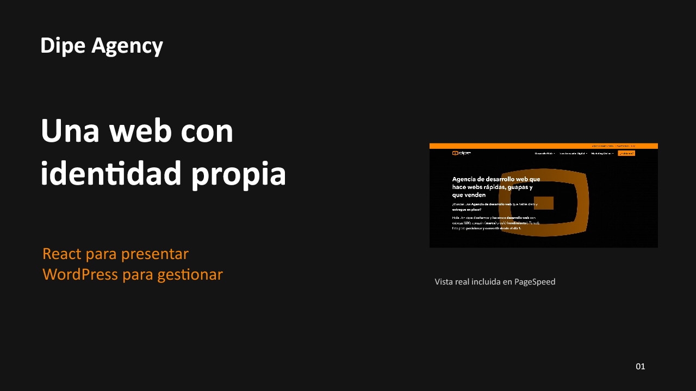

# Dipe Agency · WordPress y React

**Diseño a medida, gestión editorial en WordPress y una interfaz construida con React.**

Este proyecto combina un panel conocido para publicar contenido con una experiencia visual propia: páginas corporativas, servicios, proyectos, blog, animaciones y formularios. La presentación recorre las decisiones de arquitectura, el proceso de construcción y los primeros resultados documentados; debajo se encuentra la documentación para entender y continuar la implementación.

## Presentación del proyecto

[](https://raw.githubusercontent.com/mariocdev/dipe-agency-React/refs/heads/codex/auditoria-refactor-2026-10-19/docs/presentacion/Dipe-Agency.pptx)

**[Descargar presentación · PowerPoint editable](https://raw.githubusercontent.com/mariocdev/dipe-agency-React/refs/heads/codex/auditoria-refactor-2026-10-19/docs/presentacion/Dipe-Agency.pptx)** · 12 diapositivas, incluidos dos anexos de métricas.

El enlace entrega el archivo para abrirlo en PowerPoint o una aplicación compatible; la imagen de arriba es la vista previa de su portada.

La presentación explica qué aporta separar contenido e interfaz, cómo se reparten React, el tema y el plugin propio, qué se administra desde WordPress y cómo se prepara el paso a producción. Incluye resultados PageSpeed de cinco plantillas en móvil y escritorio. La prueba de resultados enriquecidos permanece identificada como pendiente.

## La idea: conservar WordPress y controlar la experiencia

En una web WordPress tradicional, el tema genera gran parte de lo que ve el visitante. En una arquitectura **headless**, WordPress gestiona el contenido y una interfaz independiente lo consume mediante una API. Esto permite trabajar el diseño y la interacción con herramientas de frontend sin sustituir necesariamente el sistema editorial.

Dipe aplica esa separación con una solución integrada: **React se sirve dentro de un tema del propio WordPress**. WordPress conserva las URL, los estados HTTP y los metadatos; React dibuja las páginas y obtiene los datos editoriales por REST. No hay un segundo servidor Node en producción.

```text
WordPress                       Tema dipe-react                  React
Contenido, menús y logos  →      Documento y recursos      →      Diseño e interacción
       ↑                                                              │
       └────────────────── REST API + dipe-core ────────────────────────┘
```

La web combina tres piezas con responsabilidades claras: frontend React, tema ligero y plugin `dipe-core`. El contenido y la lógica del negocio permanecen separados de la maquetación.

## Qué aporta este enfoque

| Ventaja | Aplicación concreta en Dipe |
| --- | --- |
| Identidad visual propia | Secciones, tarjetas, responsive y animaciones ajustados al diseño, sin depender de un constructor visual |
| Administración conocida | Entradas, proyectos, equipo, medios, menús y logos se gestionan desde WordPress |
| Coherencia entre páginas | Tokens, componentes y lógica compartida para mantener tipografía, navegación y comportamiento |
| Evolución del diseño | El modelo editorial vive en el plugin, separado del tema, para reducir el acoplamiento con una interfaz concreta |
| Control de las integraciones | Formularios propios con validación en servidor, solicitudes privadas y correo mediante WordPress/PHPMailer |
| Optimización dirigida | Recursos compilados, carga diferida y caché, con mediciones por plantilla para decidir mejoras |
| Continuidad del desarrollo | Código y decisiones documentados, con una guía para reproducir el enfoque con contenido propio |

El beneficio principal es disponer de una experiencia propia manteniendo una herramienta editorial familiar. Rendimiento, accesibilidad, SEO y conversión se trabajan y se miden: no aparecen automáticamente por elegir React o headless.

### Qué se puede editar y qué requiere desarrollo

**Desde WordPress:** entradas y categorías, proyectos y sus campos, equipo, medios, menús, logos y ajustes disponibles de SEO y formularios.

**Desde React/CSS:** estructura y textos de las páginas corporativas, secciones, diseño, responsive y animaciones. Esta versión no es un editor visual de todas las páginas.

El cuerpo principal se dibuja en el navegador, sin SSR ni prerender en la versión documentada. WordPress y Yoast aportan los metadatos; el renderizado, el contenido visible y la indexación deben revisarse también. La solución necesita mantenimiento de frontend, WordPress y plugins, además de copias y revisión en servidor.

## Referencias reales del enfoque

Hay implementaciones documentadas tanto en grandes plataformas como en comercios especializados. Los siguientes casos describen proyectos publicados por sus proveedores o equipos de desarrollo; son referencias de arquitectura, no una auditoría del estado actual de cada dominio ni una promesa de repetir sus resultados.

### Corporativas y plataformas de contenido

| Proyecto | Implementación documentada | Qué ilustra |
| --- | --- | --- |
| **WP Engine** · corporativa tecnológica | Drewl documenta una arquitectura headless con WordPress, React, Faust, GraphQL y ACF | Una web corporativa puede mantener WordPress y desarrollar su experiencia y sistema de diseño en React. [Caso del equipo responsable](https://drewl.com/projects/wp-engine/) |
| **Al Jazeera** · medio internacional | WordPress VIP documenta una plataforma desacoplada con WordPress, GraphQL y React | La separación puede servir a una operación editorial internacional, conservando herramientas para publicar contenido. [Caso de WordPress VIP](https://wpvip.com/case-studies/al-jazeera/) |

### Tiendas con WooCommerce headless

| Proyecto | Implementación documentada | Qué ilustra |
| --- | --- | --- |
| **Gourmet Basket** · regalos y cestas, con demanda estacional | Blaze Commerce documenta su paso a headless manteniendo productos y pedidos en WooCommerce | Se puede renovar el escaparate conservando la administración y las integraciones comerciales existentes. [Caso del proveedor](https://blazecommerce.io/blog/woocommerce-headless-case-study-gourmet-basket-instant-pageloads/) |
| **WeWantSaké** · comercio especializado | WonderWeb documenta un frontend Next.js en Vercel con el backoffice WooCommerce | El enfoque también aparece en un comercio especializado, con catálogo y fichas propios. [Caso del equipo responsable](https://www.wonderweb.pro/en/projets/wewantsake) |

Referencias consultadas el **19-10-2026**. Se incluyen proyectos de alcance internacional y negocios especializados; no se atribuyen categorías de tamaño empresarial sin datos que las acrediten. Sus infraestructuras y formas de renderizar no son idénticas a las de Dipe.

### Tienda con WooCommerce

Una tienda puede conservar WooCommerce para catálogo y operación y desarrollar un escaparate propio. Su [Store API oficial](https://developer.woocommerce.com/docs/apis/store-api/) ofrece funciones orientadas a productos, carrito y checkout.

**El repositorio incorpora catálogo, ficha, filtros, favoritos y carrito en React, con compra, cuenta y reseñas nativas de WooCommerce.** Las sesiones usan cookies del mismo origen y Store API; el checkout mantiene los formularios y scripts nativos para las integraciones comerciales. Hay variantes de checkout normal y por pasos. La configuración comercial y la compatibilidad efectiva de pagos/envíos requieren revisión en servidor. [Implementación y alcance](docs/tienda-frontend.md).

La [refactorización del 26-10-2026](docs/refactor-2026-10-26.md) separa la carga por páginas y los módulos de comercio, conservando WordPress como autoridad de rutas, datos y reglas comerciales. La compilación y la revisión de esta entrega en servidor corresponden al usuario.

## Resultados recogidos en la presentación

La presentación aportada registra los siguientes resultados de laboratorio del **19-10-2026 en el entorno de pruebas**, con una ejecución por página y modo. No hay datos CrUX y el estado del loader no está confirmado. No son una medición nueva realizada desde este repositorio.

| Plantilla | Rendimiento móvil | Rendimiento escritorio | SEO móvil / escritorio |
| --- | ---: | ---: | ---: |
| Home | 80 | 98 | 100 / 100 |
| Agencia | 91 | 83 | 100 / 100 |
| Proyectos | 80 | 97 | 92 / 92 |
| Desarrollo web | 82 | 97 | 100 / 100 |
| WordPress | 82 | 98 | 100 / 100 |

La presentación identifica margen de mejora en la carga móvil y en los saltos de diseño de Home y Agencia; también registra una observación sobre la metadescripción de Proyectos. Las métricas completas y sus condiciones están en los anexos del PowerPoint. Estas evidencias complementan la documentación previa, sin sustituir la revisión del servidor actual.

Una puntuación SEO de Lighthouse no acredita posicionamiento o indexación. Los resultados enriquecidos siguen pendientes de evidencia y un marcado válido tampoco garantiza su aparición en Google. [Alcance de PageSpeed](https://developers.google.com/speed/docs/insights/v5/about) · [Datos estructurados y resultados de búsqueda](https://developers.google.com/search/docs/appearance/structured-data/intro-structured-data).

## Documentación técnica

La explicación completa de instalación, arquitectura, creación del tema/plugin, contenido, maquetación, animaciones e integraciones está en la **[guía técnica del proyecto](docs/guia-tecnica.md)**.

| Área | Documentos |
| --- | --- |
| Arquitectura e instalación | [Guía técnica](docs/guia-tecnica.md) · [Modelo de contenido](docs/modelo-contenido.md) · [Propuesta editorial inicial](docs/arquitectura-editorial.md) |
| Diseño y frontend | [Guía visual](docs/guia-visual.md) · [Cabecera y footer](docs/maquetacion-cabecera-footer.md) · [Reseñas](docs/resenas-home.md) |
| Contenido editorial | [Proyectos](docs/proyectos.md) · [Blog y rutas](docs/blog-rutas.md) · [Entradas](docs/entradas.md) · [Equipo](docs/equipo.md) |
| Formularios y correo | [Flujo, solicitudes y configuración](docs/formularios.md) |
| SEO y rendimiento | [Yoast y SEO](docs/seo.md) · [Caché y rendimiento](docs/cache-rendimiento.md) |
| Seguridad y mantenimiento | [Auditoría y mejoras](docs/auditoria-refactor-seguridad-2026-10-19.md) · [Revisión del repositorio público](docs/repositorio-publico.md) |
| Paso a producción | [Plan de lanzamiento, migración y recuperación](docs/plan-lanzamiento.md) |
| Presentación | [Descargar PowerPoint](https://raw.githubusercontent.com/mariocdev/dipe-agency-React/refs/heads/codex/auditoria-refactor-2026-10-19/docs/presentacion/Dipe-Agency.pptx) · [Prompt de preparación y actualización](docs/prompt-presentacion-work.md) |

Para continuar el desarrollo: [estado breve](PLAN_PARA_TERRA.md), [contexto operativo](CONTEXTO-PROYECTO.md) y [directrices de trabajo](AGENTS.md). Los documentos históricos conservan decisiones anteriores; el estado actual del código y las notas vigentes prevalecen sobre propuestas antiguas.

<details>
<summary>Pruebas e histórico</summary>

- [Utilidad de contenido de prueba y paginación](docs/paginacion-pruebas.md).
- [Prueba vertical inicial, con su CPT ya retirado](docs/prueba-vertical.md).
- [Histórico de contexto del 18-10-2026](docs/historico-contexto-2026-10-18.md).

</details>

## Qué incluye este repositorio

Comparte React, el tema `dipe-react`, el plugin `dipe-core` y documentación. **No incluye los uploads originales, la base de datos, las entradas, los proyectos, las solicitudes, las credenciales ni los paquetes de plugins de terceros.** Clonarlo y subir React no reproduce la web completa: cada instalación necesita WordPress, configuración, medios y contenido propios.

Sí se conservan textos corporativos en código, iconos, fuentes, capturas de documentación y la presentación. La entrega al servidor y su revisión corresponden al propietario; Git no despliega la web.

Hacer público el repositorio no incorpora licencias de terceros. La licencia del código propio y el permiso de redistribución de Gordita quedan pendientes de confirmación por el titular; ver [revisión de publicación](docs/repositorio-publico.md).
